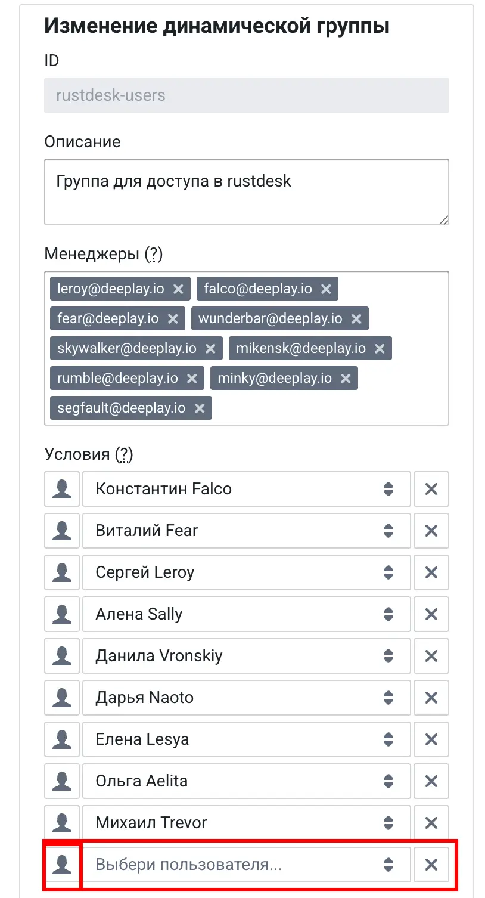

Bouncer управляет тем, кто может логинится в rustdesk. Нужно перейти по ссылке и найти группу `rustdesk-users` > Изменить > + Условие > Ввести почту сотрудника > Удостовериться что на иконке 1 человек > Сохранить.



> [!IMPORTANT]
> Удаление юзера из группы bouncer не удаляет пользователя из rustdesk, но больше не позволит ему залогиниться

