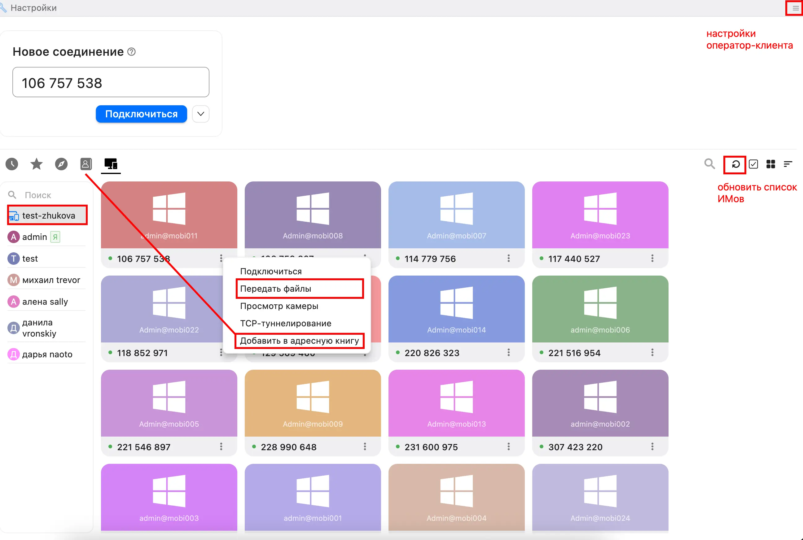
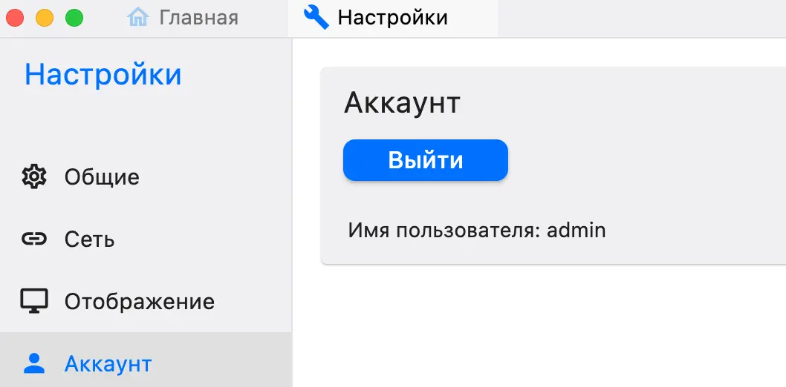
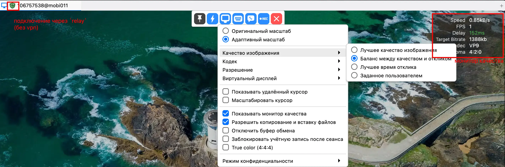
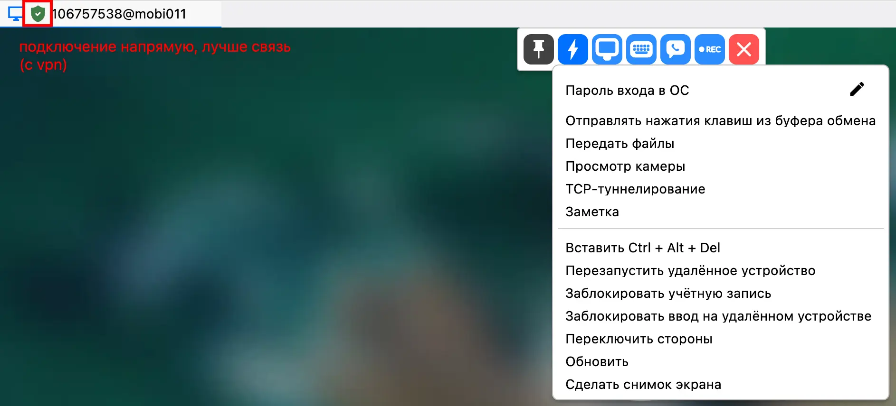

## Основное окно

Основное окно после подключения представлят скриншот ниже, где
* Адресная книга - позволяет создавать *личные избранные* имы которыми вы часто пользуетесь
* Передача файлов ЦУП<>ИМ без подключения к видеопотоку
* Настройка клиента ЦУПа + Выход из своего аккаунта
* Обновить список подключений (например если добавили новые ИМы и вы не хотите перезапускать клиент)

> [!CAUTION]
> Все подключения логгируются и сохраняются, если вы не выходите из своей учётной записи, то будет отображено что подключения совершались от вашего лица

## Окно подключения

Обладает множестом параметров, но основные выделены на скриншотах

* Качество изображения - выбирать на своё усмотрение
* Кодек - по умолчанию vp9, при проблемах выбирать h264 или h265
* Разрешение - наименьшее удобное для работы
* Виртуальный дисплей - не использовать
* Режим конфиденциальности - не использовать (делает физический экран тёмным у ИМа)