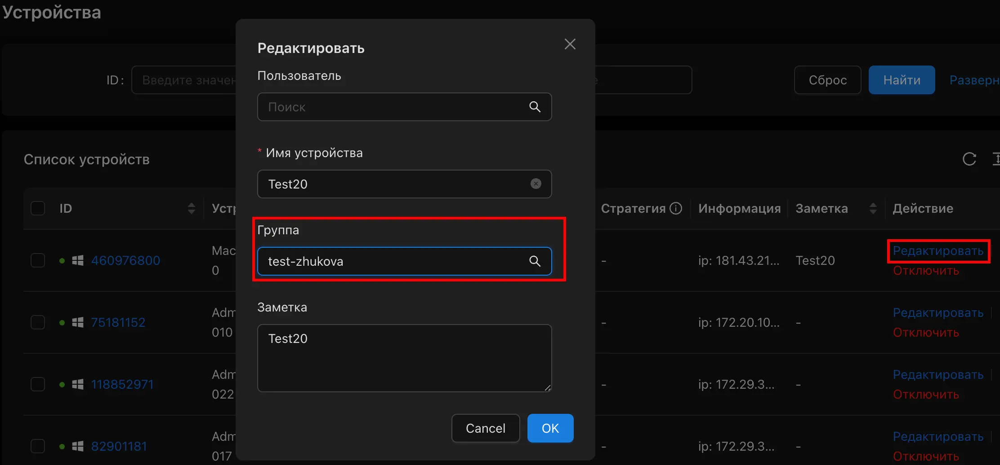
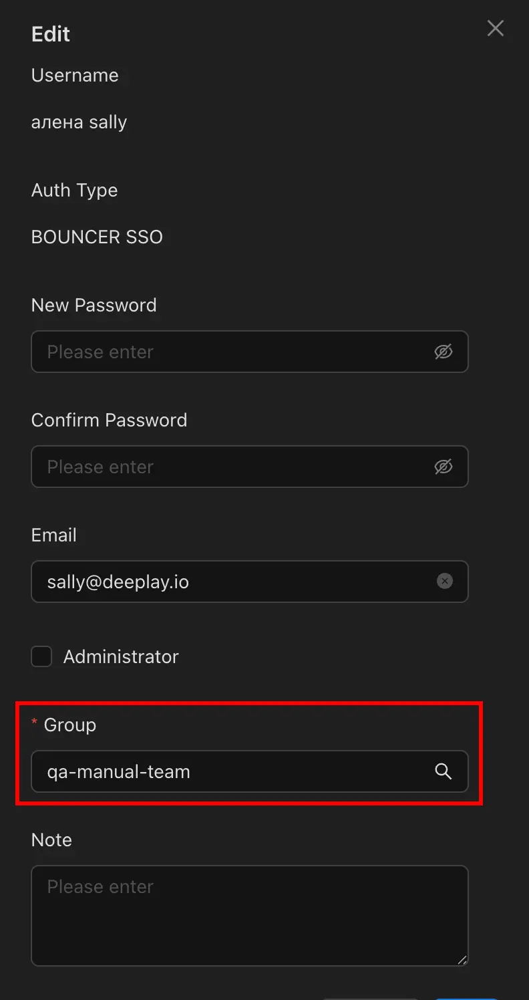
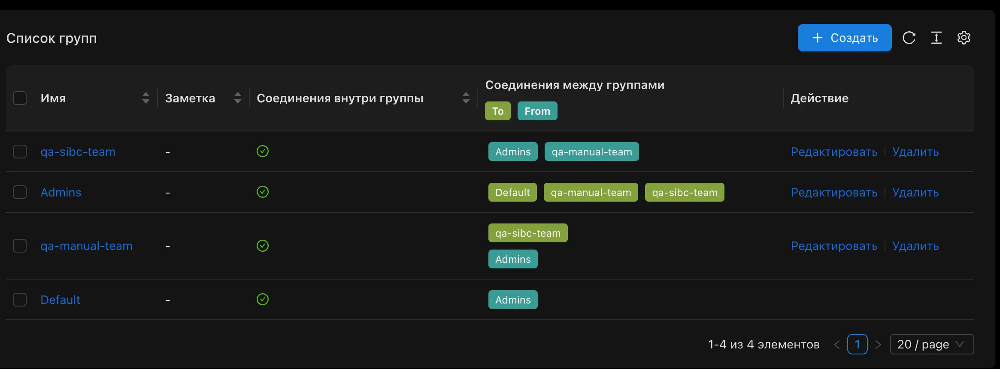
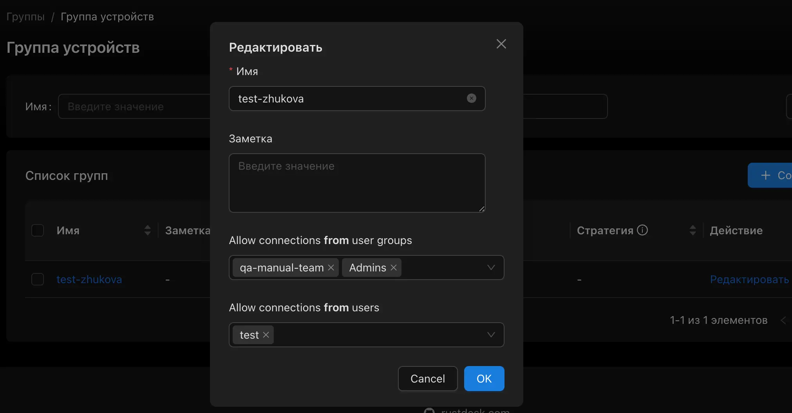
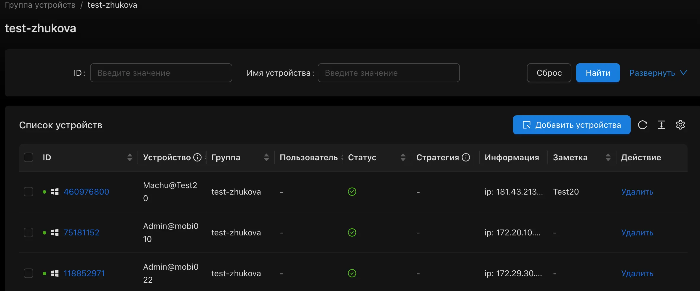

## Devices / Устройства

Позволяет увидеть информацию о ИМах подключённых к rustdesk и их статус. После установки `client-im` на им, следует назначить устройству соответствующую группу устройств, и переименовать в человекоудобное имя.

> [!IMPORTANT]
> Удалить устройство можно только после удаления `client-im` с има (удаление сервиса), отключения в веб-консоли устройства, далее появится кнопка удалить

## Logs / Аудит Безопасности

В данном разделе можно увидеть

* Список подключений / попыток подключений, время старта/завершения сессии
* Список переданных файлов
* Множественные неудачные попытки подключений
* Действия администраторов в Веб-консоли

## Users / Пользователи

Список пользователей которые залогинилсь через Bouncer. Пользователь не появится автоматически при добавлении в группу баунсера, ему нужно залогинится внутри rustdesk, через клиент-цуп или веб страницу. После логина пользователя нужно добавить в группу внутри rustdesk, тогда у него появится возможность подлючаться к ИМам.

## Groups / Группы

Состоит из 2 разделов

* Группа пользователей
* Группа устройств

### User Groups / Группа пользователей

Состоит из пользователей, пользователь может состоять только в 1 группе. Соединия между группами позволяют указывать межсвязи. На скриншоте ниже пример, что группа `Admins` может подключаться ко всем группам, группа `qa-manual-team` может подключаться к группе `qa-sibc-team`, группа `qa-sibc-team` может подключаться только к своим устройствам.

### Device Groups / Группы устройств

Состоит из устройств и позволяет назначать группы пользователей или разрешать конкретным пользователям подключения. После установки `client-im` нужно назначить устройство на группу устройств. По умолчанию назначается группа `Default` к которой есть доступ только у администраторов

### Address Books / Адресная книга

Позволяет создавать не стандартные адресные книги (с тэгами) и делиться ими между группами. Необходимость этого функционала сомнительна, но может стать полезна.

## Остальное

Не редактировать, не копировать, не трогать! Подробнее в технической документации